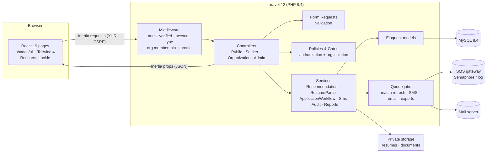
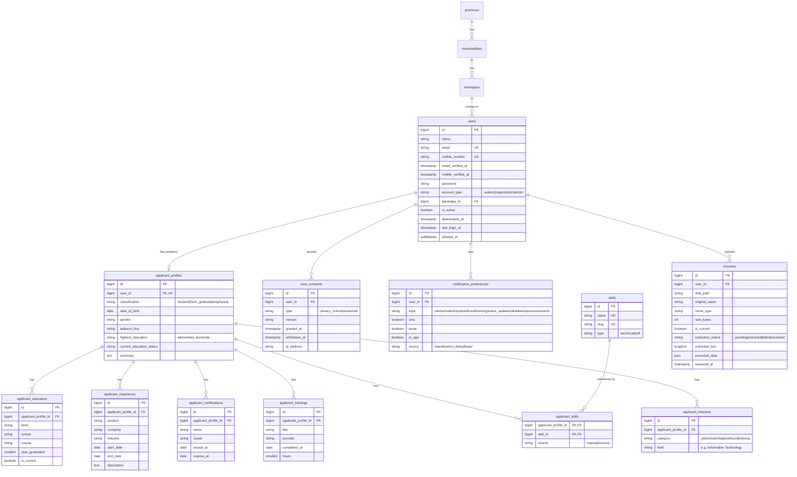
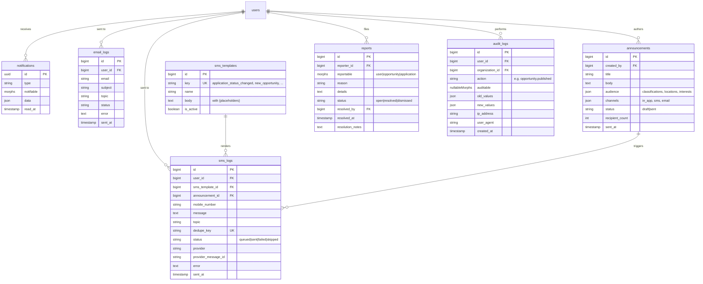
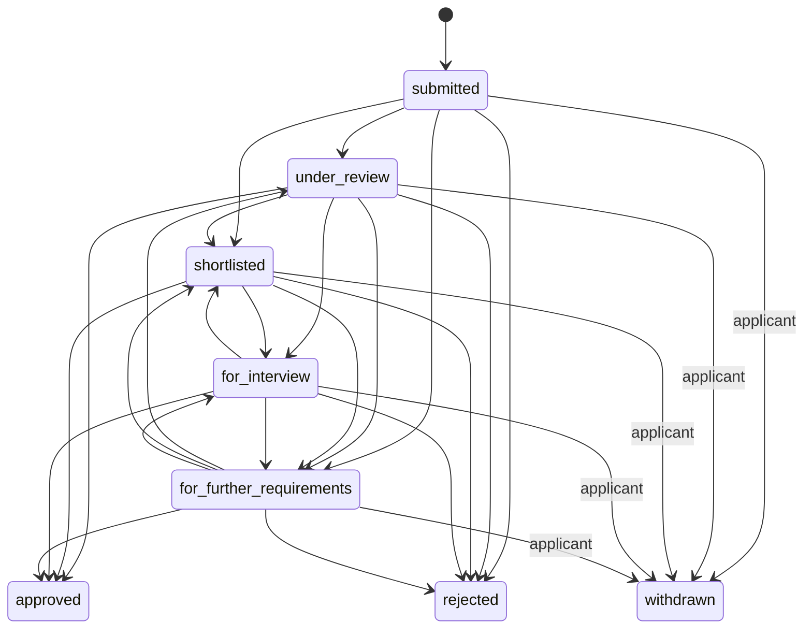

# JoBauko — System Architecture

This document is the design baseline for JoBauko, the opportunity portal for the
Municipality of Bauko, Mountain Province. Database-dependent
modules are implemented against the schema described here; changes to the schema
should be reflected in this file first.

---

## 1. Architecture overview



**Key principles**

- **Server-driven UI via Inertia.** Laravel controllers own routing, authorization,
  validation and data loading; React pages receive props and never call a separate API.
  Business rules (eligibility of an application, allowed status transitions, scoring)
  live only in PHP services. The frontend renders state and sends intent.
- **Thin controllers, explicit services.** Multi-step operations (submitting an
  application, changing a status, verifying an organization) run inside services that
  wrap a DB transaction, write the audit log and dispatch notifications.
- **Two separate concepts for "who a user is":**
  - `users.account_type` — the *permission* role: `seeker`, `organization`, `admin`.
  - `applicant_profiles.classification` — a *profile attribute* of seekers
    (Student, Fresh Graduate, ...). It is never consulted for authorization.
- **Organization isolation.** Every organization-owned record carries (directly or via
  its opportunity) an `organization_id`. Organization controllers resolve the acting
  member's organization from the session and scope every query to it; policies
  re-check ownership on every record-level action.
- **Private files.** Resumes and documents are stored on the private `local` disk
  (`storage/app/private`) and streamed through controllers after a policy check.
  Nothing personal is ever placed on the `public` disk (only organization logos).

## 2. Users, roles and permissions

| Actor | `account_type` | Area | Notes |
|---|---|---|---|
| Opportunity Seeker | `seeker` | `/dashboard`, `/opportunities`, `/applications`, ... | Has one `applicant_profile` with a classification |
| Organization personnel | `organization` | `/org/...` | Belongs to exactly one organization through `organization_members` |
| System Administrator | `admin` | `/admin/...` | Platform-wide monitoring; does not decide applications |

**Organization member roles** (`organization_members.role`) map to permissions in code
(`App\Enums\OrganizationRole::permissions()`):

| Permission | Org Administrator | Recruitment Officer | Application Reviewer |
|---|:-:|:-:|:-:|
| Manage organization profile & documents | ✓ | | |
| Manage personnel | ✓ | | |
| Create / edit / publish opportunities | ✓ | ✓ | |
| View applications & applicant profiles | ✓ | ✓ | ✓ |
| Add internal remarks | ✓ | ✓ | ✓ |
| Change application status | ✓ | ✓ | ✓ (up to Shortlisted / For Interview) |
| Approve / reject applications | ✓ | ✓ | |

A user belongs to at most one organization (unique `organization_members.user_id`).
This keeps the "current organization" unambiguous and the isolation rules simple.

Organizations must be `verified` before any member can publish opportunities.

**Enforcement.** Organization routes use `org.member` (active membership) and
`org.can:{permission}` (e.g. `org.can:view_applications`); record-level checks are in
`ApplicationPolicy` / `OpportunityPolicy`. The member's role and permissions are
shared with the frontend as `auth.organization` so navigation hides what the role
cannot use; the server never relies on that.

**Personnel.** Organization administrators add personnel by name, email and role
(`PersonnelService`). This creates an organization account with an unusable password
and emails a signed invitation link (`invitations.show`, valid 3 days, resendable).
Accepting it sets the password, verifies the email and signs the person in. An email
that already has an account cannot be invited, so a person never belongs to two
organizations and a seeker account never becomes personnel. Members are deactivated,
never deleted, so their status changes and remarks stay attributable. Nobody can change
their own role or access, and the last active administrator cannot be demoted or
deactivated (checked under a row lock).

**Applicant review.** The applicant list is scoped to the organization's own
opportunities and can be filtered by opportunity, status and name and sorted by the
match score stored at submission (`applications.match_score`). The review page shows
the profile, resume, documents, cover letter, a live match score, the status history,
allowed next statuses for the member's role, and internal remarks. Each opening of the
review page is written to the audit log (`application.viewed`), since it discloses
personal data.

**Administration.** All system administrators have the same rights; every action
below is written to the audit log.

- *Accounts* (`AccountStatusService`). Deactivation requires a reason, ends all of the
  person's sessions at once (database session rows are deleted) and emails them the
  reason. Accounts are never deleted from the admin area. Admins cannot deactivate
  themselves, which also guarantees one active administrator always remains. Opening a
  user's page is logged (`user.viewed`). Admins see a seeker *summary* (classification,
  profile completeness, application statuses), not the full profile or documents, which
  are shared only with organizations the seeker applies to.
- *Opportunities* (`OpportunityService::suspend/reinstate`). Drafts, published and
  closed listings can be suspended with a reason sent to the organization. The previous
  status is stored (`status_before_suspension`) and restored on reinstatement. A
  suspended listing is hidden and locked; applications already received stay with the
  organization.
- *Applications*. Read-only monitoring across organizations: status, dates and an
  indicator for open applications with no status change in 14 days
  (`Application::scopeStalled`). Cover letters, documents and remarks are not shown.
- *Reports* (`ReportService`). Signed-in users other than admins and the publishing
  organization can report a visible listing, once while a report is open. The
  organization is never told who reported. An admin decision (suspend, resolved another
  way, dismiss) closes every open report on the same listing; reporters get an in-app
  notice of the outcome without the admin's notes.

## 3. Database design

Conventions: `bigint unsigned` auto-increment keys, `timestamps()` on all mutable
tables, foreign keys with explicit `ON DELETE` behavior, PHP-backed enums stored as
`varchar` (portable and easy to extend), soft deletes on records users or
administrators "remove" but that must remain for history: `users`, `organizations`,
`opportunities`, `applications`.

### 3.1 ERD — identity, location and applicant profile



### 3.2 ERD — organizations, opportunities and applications

```mermaid
erDiagram
    organizations ||--o{ organization_members : employs
    users ||--o| organization_members : "is member"
    organizations ||--o{ organization_documents : submits
    organizations ||--o{ opportunities : publishes
    opportunities ||--o| job_details : "category=job"
    opportunities ||--o| scholarship_details : "category=scholarship"
    opportunities ||--o| livelihood_details : "category=livelihood"
    opportunities ||--o{ opportunity_requirements : lists
    opportunities ||--o{ opportunity_skills : requires
    skills ||--o{ opportunity_skills : "referenced by"
    opportunities ||--o{ opportunity_documents : "requires docs"
    opportunities ||--o{ applications : receives
    users ||--o{ applications : submits
    applications ||--o{ application_documents : attaches
    opportunity_documents ||--o{ application_documents : fulfills
    applications ||--o{ application_status_histories : logs
    applications ||--o{ application_remarks : "internal notes"
    users ||--o{ saved_opportunities : bookmarks
    opportunities ||--o{ saved_opportunities : "bookmarked in"
    users ||--o{ opportunity_matches : "scored for"
    opportunities ||--o{ opportunity_matches : "scored against"

    organizations {
        bigint id PK
        string name
        string slug UK
        string type "private|lgu|national_agency|educational|ngo|other"
        string official_email
        string contact_number
        string office_address
        bigint barangay_id FK "nullable; offices outside Bauko use office_address"
        text description
        string logo_path
        string representative_name
        string representative_position
        string verification_status "pending|verified|rejected|suspended"
        timestamp verified_at
        bigint verified_by FK
        text status_reason
        softdeletes deleted_at
    }
    organization_members {
        bigint id PK
        bigint organization_id FK
        bigint user_id FK,UK
        string role "admin|recruitment_officer|reviewer"
        boolean is_active
        bigint invited_by FK
    }
    organization_documents {
        bigint id PK
        bigint organization_id FK
        string document_type
        string disk_path
        string original_name
        string mime_type
    }
    opportunities {
        bigint id PK
        bigint organization_id FK
        bigint created_by FK
        string category "job|scholarship|livelihood"
        string title
        string slug UK
        text description
        text qualifications
        text benefits
        text application_instructions
        string min_education "nullable"
        bigint barangay_id FK "Bauko barangay, nullable"
        string location_text "outside Bauko"
        boolean is_remote
        date application_start
        date application_deadline
        int slots "nullable"
        string contact_email
        string contact_number
        string status "draft|published|closed|archived|suspended"
        timestamp published_at
        timestamp reopened_at
        text suspension_reason
        softdeletes deleted_at
    }
    job_details {
        bigint opportunity_id PK,FK
        string employment_type "full_time|part_time|contract|internship|..."
        decimal salary_min
        decimal salary_max
        string work_setup "onsite|hybrid|remote"
        tinyint min_experience_years
    }
    scholarship_details {
        bigint opportunity_id PK,FK
        string education_level
        json eligible_courses
        text academic_requirements
        text financial_requirements
    }
    livelihood_details {
        bigint opportunity_id PK,FK
        string assistance_type "starter_kit|cash_grant|training|loan|..."
        text target_beneficiaries
        text assistance_provided
        text training_requirements
        json target_classifications
    }
    opportunity_requirements {
        bigint id PK
        bigint opportunity_id FK
        text description
        smallint sort_order
    }
    opportunity_skills {
        bigint opportunity_id PK,FK
        bigint skill_id PK,FK
        boolean is_required
    }
    opportunity_documents {
        bigint id PK
        bigint opportunity_id FK
        string name "Resume, Transcript, ..."
        boolean is_required
        string accepted_types
    }
    applications {
        bigint id PK
        bigint opportunity_id FK
        bigint user_id FK
        bigint resume_id FK
        text cover_letter
        string status "submitted|under_review|shortlisted|for_interview|for_further_requirements|approved|rejected|withdrawn"
        timestamp submitted_at
        timestamp first_reviewed_at
        timestamp decided_at
        timestamp withdrawn_at
        softdeletes deleted_at
    }
    application_documents {
        bigint id PK
        bigint application_id FK
        bigint opportunity_document_id FK
        string disk_path
        string original_name
        string mime_type
    }
    application_status_histories {
        bigint id PK
        bigint application_id FK
        string from_status
        string to_status
        bigint changed_by FK
        text remarks
        timestamp created_at
    }
    application_remarks {
        bigint id PK
        bigint application_id FK
        bigint user_id FK
        text body
    }
    saved_opportunities {
        bigint user_id PK,FK
        bigint opportunity_id PK,FK
        timestamp created_at
    }
    opportunity_matches {
        bigint user_id PK,FK
        bigint opportunity_id PK,FK
        tinyint score "0-100"
        json reasons
        timestamp computed_at
    }
```



### 3.3 ERD — notifications, moderation and auditing



### 3.4 Relationship notes

- **users → applicant_profiles (1:0..1).** Only seekers get a profile. Classification is
  stored here, not on `users`, so it can never be confused with a permission role.
- **Location** is normalized into `provinces → municipalities → barangays` (PSGC codes
  in a `psgc_code` column). JoBauko serves Bauko, Mountain Province, so only its 22
  barangays are seeded. Users store only `barangay_id`; the municipality and province
  follow from it. Opportunities may be in a Bauko barangay (`barangay_id`) or elsewhere
  (`location_text`, e.g. Baguio City, or `is_remote`).
- **Profile completion** is computed from the profile tables when needed, not stored.
- **skills** is a shared dictionary. `applicant_skills` and `opportunity_skills` are
  pivots onto it, so skill matching is an ID intersection instead of fuzzy text
  comparison. The resume parser also matches extracted text against this dictionary.
- **Category-specific opportunity fields** use one-to-one detail tables
  (`job_details`, `scholarship_details`, `livelihood_details`) keyed by
  `opportunity_id`. Shared fields stay in `opportunities`; no nullable column sprawl.
- **applications** has a unique index on `(opportunity_id, user_id)` (one application
  per seeker per opportunity; a withdrawn application can be reactivated by the
  service rather than duplicated).
- **application_status_histories** is append-only and written in the same transaction
  as the status change. It records from/to status, who, when and remarks.
- **application_remarks** are internal to the organization and are never sent to the
  seeker; seeker-facing explanations go in the status history `remarks`.
- **opportunity_matches** caches recommendation results. It is derived data: a seeker's
  rows are recomputed on their next visit after their profile or any opportunity changed
  (see section 4), so scores are never stale and nothing runs for inactive seekers.
- **sms_logs.dedupe_key** (e.g. `status:{application_id}:{status}`) has a unique index,
  so the same message cannot be sent twice even if a job is retried.
- **audit_logs** has no `updated_at`; the model refuses updates and deletes, and MySQL
  triggers reject `UPDATE`/`DELETE` statements on the table.

### 3.5 Key indexes

| Table | Index | Purpose |
|---|---|---|
| opportunities | `FULLTEXT(title, description, qualifications)` | keyword search |
| opportunities | `(status, category, application_deadline)` | browse + filter |
| opportunities | `(organization_id, status)` | org dashboard |
| opportunities | `barangay_id` (FK index) | location filter |
| applications | `UNIQUE(opportunity_id, user_id)`, `(user_id, status)`, `(opportunity_id, status)` | tracking & dashboards |
| application_status_histories | `(application_id, created_at)` | timelines |
| opportunity_matches | `(user_id, score)` | dashboard recommendations |
| users | `(account_type, is_active)`, `created_at` | admin lists & trends |
| applicant_profiles | `classification` | announcement targeting |
| sms_logs | `UNIQUE(dedupe_key)`, `(status, created_at)` | dedupe & delivery monitoring |
| audit_logs | `(auditable_type, auditable_id)`, `(organization_id, created_at)`, `action` | audit browsing |

## 4. Recommendation engine (explainable)

`App\Services\Recommendation\MatchScorer` scores a (seeker profile, opportunity) pair as
a weighted sum of independent criteria. Each criterion returns points *and* a
human-readable reason, so every score shown to a user can be traced back to its parts.

| Criterion | Weight | Example reason |
|---|---:|---|
| Skills overlap (profile + reviewed resume skills ∩ opportunity skills) | 35 | "You have 4 of 5 required skills: Laravel, MySQL, ..." |
| Education level meets the minimum | 20 | "Your Bachelor's degree meets the College graduate requirement" |
| Field / course relevance (course, experience industry vs. eligible courses / keywords) | 15 | "Your BS Information Technology course is eligible" |
| Classification fit (e.g. scholarships ↔ students, livelihood target groups) | 10 | "This program targets Out-of-School Youth" |
| Location (same municipality > same province > remote) | 10 | "Located in your municipality, Tagum City" |
| Stated interests (category and field) | 10 | "You are interested in Agriculture livelihood programs" |

Rules:

- Criteria the opportunity doesn't specify are excluded from the denominator, so a
  posting with no skill list isn't scored down for it. The final score is normalized to 0–100.
- Freshness: `MatchRefresher` keeps a global version (bumped when an opportunity or an
  organization's verification changes) and a per-seeker marker (cleared by the
  `matches.invalidate` middleware on any profile change). When they differ, the seeker's
  scores are recomputed before the dashboard or browse page is shown. The details page
  always scores live.
- Public visibility: only published or closed opportunities of *verified* organizations
  are listed (`Opportunity::visible()`); recommendations use the open subset.
- Only opportunities that are currently open are scored. Scores below 30 aren't shown
  as recommendations but **never** block browsing or applying.
- The UI labels the score as a *match indicator*, not an eligibility decision, and shows
  the reasons plus "Improve your matches" links to the profile sections that would help.
- No machine-learned or random component exists; identical inputs give identical scores.

## 5. Resume handling

1. Upload (PDF/DOCX, ≤ 5 MB, MIME + extension checked) → stored at
   `storage/app/private/resumes/{user_id}/{uuid}.{ext}`.
2. `ResumeService` extracts text during the upload request (`smalot/pdfparser` for
   PDF, `ZipArchive` + `word/document.xml` for DOCX; typically well under a second)
   and `ResumeDataExtractor` applies rules: section headings, skills (dictionary
   match), education (degree keywords, school names, years), work experience (date
   ranges), certifications (NC / eligibility / license patterns), trainings and
   keywords. Scanned (image-only) files are marked failed with an explanation.
   Extraction runs synchronously so it works without a queue worker; it can be moved
   to a queued job if uploads grow large.
3. The result is stored as `extracted_data` with status `extracted`. **It isn't used
   for matching** until the user opens the review screen, corrects it and confirms.
   Confirmed items are merged into the profile tables (`source = resume`).
4. Preview/download go through `ResumeController` behind `ResumePolicy` (owner, or
   members of an organization the seeker applied to).

## 5a. Application workflow

`App\Services\Applications\ApplicationWorkflow` owns every change to an application;
allowed moves are defined on `App\Enums\ApplicationStatus::nextStatuses()`.



- **Submitting** requires a visible opportunity inside its application period, the
  applicant's consent to share their data with that organization (stored as
  `data_sharing_consented_at`), every required document (type and 5 MB limit per the
  requirement), and a resume for jobs. One application per seeker per opportunity;
  a withdrawn application cannot be resubmitted.
- **Files** are stored at `storage/app/private/applications/{id}/{uuid}.{ext}` and
  served by `ApplicationDocumentController` after `ApplicationPolicy::view` (the
  applicant, or active personnel of the receiving organization with
  `view_applications`). Everyone else gets 404. Document labels are copied at
  submission so later edits of the opportunity don't change them. The resume used is
  kept even if the seeker later replaces it.
- **Status changes** by the organization: reviewers may move applications along;
  `approved` / `rejected` need `decide_applications`. `for_further_requirements`
  requires remarks for the applicant, and while in that status the applicant can upload
  additional documents. `first_reviewed_at` and `decided_at` are set automatically.
- Every step writes `application_status_histories` (remarks there are visible to the
  applicant), an `audit_logs` row, and an in-app notification to the other side
  (`ApplicationStatusUpdated` to the applicant, `ApplicationActivity` to personnel).
  Email/SMS delivery by preference is added with the notification pipeline (Phase 9).
- `application_remarks` are internal notes of the organization and are never sent to
  the applicant.

## 5b. Reports, analytics and the audit log

- **Reports** (`app/Reports`). Each report is a class extending `Report`. Its
  `build(ReportPeriod)` returns a `ReportResult`: summary figures, chart series and
  `ReportTable`s. The web page (`/admin/analytics/{key}`), the PDF
  (`resources/views/reports/pdf.blade.php`, dompdf, landscape when a table has more
  than 6 columns) and the Excel workbook (`SpreadsheetExporter`, one sheet per table)
  all render that same result, so the three never disagree.
- **Period.** `from`/`to` (inclusive), defaulting to the current year so far. Each
  report states which date it filters on, for example the account creation date or the
  approval date.

  | Report | Contents |
  |---|---|
  | Registered users | New accounts by type; seekers by classification × sex; age groups; per month |
  | Organizations | Registrations by type and verification status, personnel, listings |
  | Published opportunities | Listings first published, status today, slots, applications, approvals |
  | Applications | Status mix, outcomes by category and classification, approval rate, time to first review |
  | Approved applicants | **Named list** of people approved, with barangay, classification and organization |
  | Opportunity categories | Supply and demand per category; breakdowns by employment type, education level, assistance type |
  | Geographic distribution | Per barangay: seekers, local listings, applications and approvals by residents |
  | Organization activity | Per organization: listings, applications received, reviewed and decided, applications waiting 14+ days, average days to first review |

- **Privacy.** All reports are aggregates except *Approved applicants*
  (`containsPersonalData()`). Viewing it is logged (`report.viewed`), and its PDF carries
  a Data Privacy Act notice. Every export is logged (`report.exported`, with report,
  format and period) and rate-limited (30 per minute). Spreadsheet text cells are
  written as explicit strings, so names cannot be turned into formulas (CSV/formula
  injection).
- **Audit log viewer** (`/admin/audit-logs`). This is read-only: no route writes to
  the log, and the database triggers reject updates and deletes.
  - Filters: area (action prefix), action, organization, actor name or email, and date
    range.
  - Each entry shows who did what to which record, with a link to the record's admin
    page where there is one; the old → new values; and the IP address.
  - Labels live in `App\Support\AuditActions`. Add a label there when introducing a new
    action.

## 6. Notifications and SMS

- **Channels.** In-app (Laravel `database` notifications, shown under the bell and at
  `/notifications`), email (`mail`) and SMS (`SmsChannel`). In-app is always on.
- **Who gets what** (`NotificationChannels::for(user, topic)`). Seekers choose email
  and SMS per topic at *Settings → Notifications*.
  - Email needs the topic switched on and a verified email address.
  - SMS also needs an active `sms` consent in `user_consents` and a verified mobile
    number.
  - `applyClassificationDefaults()` pre-selects topics at registration
    (`source = classification_default`); saving the settings page sets `source = user`.
  - Giving or withdrawing SMS consent there goes through `ConsentRecorder`, so the
    history is kept.
  - Personnel and administrators have no topic preferences: they receive operational
    messages (verification, moderation, invitations, account status) by in-app and
    email.
- **Notices sent** (each implements `HasTopic`):

  | Notification | Topic | Trigger |
  |---|---|---|
  | `ApplicationStatusUpdated` | status_updates | organization changes an application's status |
  | `DeadlineReminder` | deadlines | daily at 07:00 (`notifications:deadline-reminders`): saved, not applied, closes within 3 days |
  | `NewOpportunityMatch` | jobs / scholarships / livelihood / training | `NotifyMatchingSeekers` job on publish or reopen; seekers who opted into the topic by email or SMS and score ≥ 60 |
  | `AnnouncementPublished` | announcements | an administrator sends an announcement |

  Automatic notices claim a key in `notification_dedupes` first, so repeated runs never
  notify twice.
- **SMS.** `SmsSender` renders the template (`sms_templates`, editable by
  administrators, placeholders fixed per `SmsTemplateKey`), caps it at 320 characters
  (two SMS, plain GSM text), and claims `sms_logs.dedupe_key`. It then sends and records
  the outcome; failures are logged, never thrown. A template that is switched off is
  not sent. Drivers: `log` (development) and `semaphore` (`SMS_DRIVER=semaphore`,
  `SEMAPHORE_API_KEY`, optional `SEMAPHORE_SENDER_NAME`).
- **Email log.** The `LogNotificationEmail` listener writes every notification email to
  `email_logs`. Administrators see both logs at *Delivery logs*, with mobile numbers
  masked. "Sent" means the provider accepted the message.
- **Announcements.** Drafted, reviewed (recipient count per channel), then sent once by
  the queued `SendAnnouncement` job in chunks of 200.
  - Audience: seekers (optionally narrowed by classification and barangay), active
    organization personnel, and/or administrators. Only active accounts with a verified
    email are included.
  - Seekers get email and SMS only if they chose them for announcements.
  - Sent announcements cannot be edited or deleted.
- **Queue.** Announcements and new-opportunity alerts run on the queue
  (`QUEUE_CONNECTION=database`). `composer run dev` starts a worker. In production run
  `php artisan queue:work` and the scheduler (`php artisan schedule:run` every minute).

## 7. Security

| Concern | Measure |
|---|---|
| Authentication | Laravel session auth (starter kit), email verification, password reset, bcrypt hashing, mobile OTP verification (hashed code in cache, throttled) |
| Authorization | Account-type middleware per area, organization-membership middleware, Policies for every model action, organization role permissions |
| Data isolation | Org queries scoped by the member's `organization_id`; policies re-check ownership; tests cover cross-organization access attempts |
| CSRF / XSS / SQLi | Laravel CSRF (Inertia sends XSRF token), React escaping (no `dangerouslySetInnerHTML` on user content), Eloquent / bound parameters only |
| Rate limiting | Login, registration, OTP, applications, report submissions, exports |
| Files | Private disk, MIME + extension + size validation, random file names, streamed via policy-checked controllers |
| Sessions | Encrypted database sessions, regenerate on login, `SESSION_SECURE_COOKIE` in production |
| Audit | `AuditLogger` service; append-only table protected by DB triggers |
| Privacy (RA 10173) | Privacy notice + consent at registration (versioned in `user_consents`), SMS consent separate and revocable, minimal data in organization views until the seeker applies, account deactivation |

## 8. Packages

| Package | Purpose |
|---|---|
| `laravel/framework` 12 | Core framework (PHP 8.4) |
| `inertiajs/inertia-laravel` 2 / `@inertiajs/react` 2 | Server-driven React pages without a separate API |
| `tightenco/ziggy` | Named Laravel routes in React (`route('opportunities.show', id)`) |
| `smalot/pdfparser` | Text extraction from PDF resumes |
| `barryvdh/laravel-dompdf` | PDF report export |
| `phpoffice/phpspreadsheet` | Excel (.xlsx) report export |
| `react` 19, `typescript` | Frontend |
| `tailwindcss` 4, shadcn/ui (Radix primitives), `class-variance-authority`, `tailwind-merge` | Styling and accessible UI components |
| `recharts` | Dashboard and report charts |
| `lucide-react` | Icons |
| `laravel/pint`, ESLint, Prettier, PHPUnit | Code style and testing |

Deliberately *not* added: a separate permissions package. The platform has three fixed
account types and one organization role per member, which enums + policies express
more clearly than a generic role/permission table.

## 9. Folder structure

```
app/
  Enums/                    AccountType, Classification, OpportunityCategory,
                            OpportunityStatus, ApplicationStatus, OrganizationRole, ...
  Http/
    Controllers/
      Public/               Landing, opportunity browse/details, org registration
      Seeker/               Dashboard, profile, resume, applications, saved, notifications
      Organization/         Dashboard, opportunities, applicants, personnel, settings
      Admin/                Dashboard, users, organizations, opportunities, monitoring,
                            notifications, reports, audit logs
      Files/                Policy-checked downloads of private files
    Middleware/             EnsureAccountType, EnsureOrganizationMember, EnsureActiveAccount
    Requests/{Seeker,Organization,Admin}/
  Models/
  Policies/
  Services/
    Recommendation/         MatchScorer, criteria classes, MatchRefresher
    Resume/                 TextExtractor, ResumeDataExtractor
    Applications/           ApplicationWorkflow (submit, transition, withdraw)
    Notifications/          SmsService, gateways, AudienceResolver
    Audit/                  AuditLogger
    Reports/                Report builders + PDF/XLSX exporters
  Jobs/  Notifications/
database/
  migrations/  factories/  seeders/  data/psgc/
resources/js/
  components/ui/            shadcn/ui primitives
  components/               shared app components (OpportunityCard, StatusBadge, ...)
  components/charts/        Recharts wrappers
  layouts/                  public, seeker, organization, admin, auth
  pages/{public,seeker,organization,admin,auth,settings}/
  types/                    shared TS types for Inertia props
routes/
  web.php  auth.php  seeker.php  organization.php  admin.php
tests/Feature/{Auth,Seeker,Organization,Admin,Security}/  tests/Unit/
docs/
```

## 10. Implementation phases

| Phase | Scope | Exit criteria |
|---|---|---|
| 1 | Project setup, architecture, ERD | Scaffold builds, baseline tests pass, this document |
| 2 | Migrations, enums, models, PSGC location data, registration with classification, account types, consent, mobile OTP | Auth tests per account type |
| 3 | Applicant profile, resume upload, extraction, review | Profile CRUD + upload/extraction tests |
| 4 | Organization registration and verification, opportunity CRUD and lifecycle | Lifecycle + isolation tests |
| 5 | Browse/search/filter, details page, saved opportunities, recommendation engine | Scoring unit tests, search tests |
| 6 | Application submission, documents, tracking, status history, withdraw | Workflow tests |
| 7 | Org dashboard, applicant management, personnel and roles | Role-permission tests |
| 8 | Admin dashboard, users, organizations, opportunity and application monitoring, reports queue | Admin tests |
| 9 | Notification preferences, SMS/email pipeline, templates, announcements | Consent/dedupe tests |
| 10 | Reports + PDF/Excel export, analytics charts, audit log viewer | Export tests |
| 11 | Security hardening, full test pass, deployment docs | Green suite, README |
